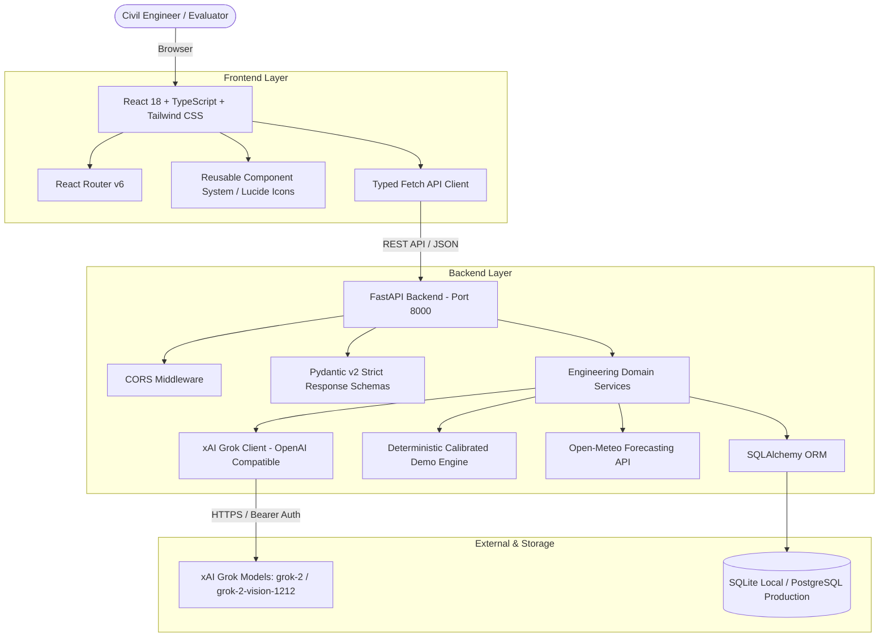

# Multimodal Construction Intelligence Platform (MCIP)

[](https://github.com)
[](https://vitejs.dev)
[](https://fastapi.tiangolo.com)
[-black)](https://x.ai)
[](https://tailwindcss.com)
[](LICENSE)

An engineering-grade, AI-powered decision-support platform designed for civil engineers, site safety officers, project managers, and real estate appraisers. Developed as an individual portfolio project for the **Skill Wallet / FutureSkills Prime Vibe Coding** course.

---

## 🏗️ Core Modules & Capabilities

1. **Construction Site Safety Monitoring**
   - High-resolution photograph upload (JPG, PNG, WebP) with 1-click verified sample loader.
   - Identifies active hazards, edge protections, scaffolding tiers, and worker PPE compliance.
   - Enforces strict evidence isolation: distinguishes visible cues from inference; documents blindspots and unverified areas.

2. **Surface Crack Detection & Diagnostic Guidance**
   - AI-assisted visual crack pattern identification (diagonal shear, vertical flexural, crazing).
   - Classifies visual pattern severity based solely on photographic evidence.
   - Outlines hypothesized structural causes, recommended non-destructive tests (UPV, tell-tale crack gauges), and statutory structural engineer disclaimers.

3. **Transparent Real Estate Valuation**
   - Mathematical Depreciated Replacement Cost (DRC) formula with building age depreciation curves (1.2%/year) and condition adjustments (+8% to -22%).
   - Transparent calculation breakdown with benchmark municipal comparables.
   - Forbids LLM price hallucinations; provides clear statutory non-certified valuation warnings.

4. **Construction Project Planning & CPM Scheduling**
   - Synthesizes 5-phase master schedules (Pre-construction, Substructure, Superstructure, MEP Rough-Ins, Commissioning).
   - Visual Gantt-style schedule timeline, task durations, dependencies, and Critical Path (CP) sequence.
   - Proactive risk matrix with mitigation strategies and persistent project database saving.

5. **AI Construction Assistant**
   - Multi-turn conversational civil engineering consultation for ASTM/IS standards, concrete mix hydration, and OSHA 1926 standards.
   - Suggested technical prompt chips and core concept tagging.

6. **Weather-Aware Advisory & Daily Site Reports**
   - Real-time meteorological forecasting integration via Open-Meteo models.
   - Operational feasibility matrix: automatic high-wind alerts for tower cranes (>45 km/h), concrete hydration heat protocols (>35°C), and excavation trench collapse risks.
   - Form-based daily shift logger generating formatted executive Markdown reports with 1-click download.

7. **Persistent Audit Trail & Analysis History**
   - Full historical logging to SQLite/PostgreSQL with search, module filtering, detail modal inspection, and deletion controls.

---

## 🏛️ System Architecture



---

## 📁 Repository Structure

```
multimodal-construction-intelligence-platform/
├── backend/
│   ├── app/
│   │   ├── api/v1/          # Modular API routes (health, safety, cracks, valuation, planning, etc.)
│   │   ├── models/          # SQLAlchemy database entities (AnalysisRecord, ProjectRecord, DailyReportRecord)
│   │   ├── schemas/         # Strict Pydantic v2 validation contracts
│   │   ├── services/        # Business logic, Grok client, and demo data generator
│   │   ├── config.py        # Pydantic Settings configuration
│   │   ├── database.py      # SQLite & PostgreSQL connection management
│   │   └── main.py          # FastAPI application lifespan & CORS entrypoint
│   ├── tests/               # 18 automated Pytest unit and integration tests
│   ├── requirements.txt     # Python dependency manifest
│   ├── pytest.ini           # Pytest testpath & pythonpath config
│   ├── Dockerfile           # Containerized deployment manifest
│   ├── render.yaml          # 1-click Render blueprint with PostgreSQL
│   └── .env.example         # Template environment variables
├── frontend/
│   ├── public/
│   │   └── samples/         # High-resolution sample construction photographs
│   ├── src/
│   │   ├── components/      # Reusable UI widgets (Navbar, Sidebar, Toast, TimelineChart, UploadZone)
│   │   ├── context/         # React Context for system status & notifications
│   │   ├── pages/           # Module page views (Safety, Cracks, Valuation, Planning, Assistant, etc.)
│   │   ├── services/        # Typed API service
│   │   ├── types/           # TypeScript interfaces mirroring backend schemas
│   │   ├── App.tsx          # Root routing and layout
│   │   └── main.tsx         # Entrypoint
│   ├── package.json         # NPM scripts and dependencies
│   ├── tailwind.config.js   # Tailored construction-tech design palette
│   ├── vite.config.ts       # Vite configuration with /api proxy
│   ├── vercel.json          # Vercel SPA rewrite rules
│   └── .env.example         # Template frontend environment variables
├── demo_script.md           # Recruiter & evaluator demonstration script
├── .gitignore               # Excludes secrets, node_modules, virtualenvs, and DB files
└── README.md
```

---

## ⚡ Quick Start Guide (Local Development)

### Prerequisites
- **Node.js** >= v18 (tested on Node v24)
- **Python** >= 3.10 (tested on Python 3.14 / 3.11)
- **Git**

---

### Step 1: Clone the Repository
```bash
git clone https://github.com/your-username/multimodal-construction-intelligence-platform.git
cd multimodal-construction-intelligence-platform
```

---

### Step 2: Set Up and Run the Backend

1. Navigate to the `backend/` directory:
   ```bash
   cd backend
   ```

2. Create and activate a Python virtual environment:
   ```bash
   # On Windows PowerShell:
   python -m venv venv
   .\venv\Scripts\Activate.ps1

   # On macOS / Linux:
   python3 -m venv venv
   source venv/bin/activate
   ```

3. Install dependencies:
   ```bash
   pip install -r requirements.txt
   ```

4. Configure environment variables (optional for demo mode):
   ```bash
   cp .env.example .env
   ```
   *Note: If `XAI_API_KEY` is left blank, the application automatically boots in **Deterministic Demo Mode**, giving you full functionality without paid quota.*

5. Run the backend server:
   ```bash
   python -m uvicorn app.main:app --host 127.0.0.1 --port 8000 --reload
   ```
   - Swagger OpenAPI Docs: [http://127.0.0.1:8000/docs](http://127.0.0.1:8000/docs)
   - Health Check: [http://127.0.0.1:8000/api/v1/health](http://127.0.0.1:8000/api/v1/health)

---

### Step 3: Set Up and Run the Frontend

1. Open a new terminal and navigate to `frontend/`:
   ```bash
   cd frontend
   ```

2. Install dependencies:
   ```bash
   npm install
   ```

3. Start the Vite development server:
   ```bash
   npm run dev
   ```
   - Open [http://localhost:5173](http://localhost:5173) in your browser.

---

## 🧪 Automated Testing

The backend includes a comprehensive automated test suite with **18 unit & integration tests** covering request validation, file size limits, invalid MIME rejection, valuation math, and CRUD persistence.

Run the tests from the `backend/` folder:
```bash
pytest -v
```

**Results:**
```
======================= 18 passed in 3.68s =======================
tests/test_health.py::test_health_check PASSED
tests/test_health.py::test_system_status PASSED
tests/test_safety.py::test_safety_analyze_demo_success PASSED
tests/test_safety.py::test_safety_analyze_unsupported_media_type PASSED
tests/test_safety.py::test_safety_analyze_empty_file PASSED
tests/test_cracks.py::test_crack_analyze_demo_success PASSED
tests/test_cracks.py::test_crack_analyze_invalid_type PASSED
tests/test_valuation.py::test_valuation_estimate_valid PASSED
tests/test_valuation.py::test_valuation_estimate_invalid_area PASSED
tests/test_planning.py::test_project_planning_generate_success PASSED
tests/test_planning.py::test_project_planning_invalid_dates PASSED
tests/test_planning.py::test_project_crud_lifecycle PASSED
tests/test_assistant.py::test_assistant_chat_concrete_query PASSED
tests/test_assistant.py::test_assistant_chat_safety_query PASSED
tests/test_weather_reports.py::test_weather_advisory_endpoint PASSED
tests/test_weather_reports.py::test_daily_site_report_generate PASSED
tests/test_weather_reports.py::test_daily_reports_list PASSED
tests/test_history.py::test_history_list_and_filter PASSED
```

Frontend production build check:
```bash
cd frontend
npm run build
# Built successfully in 4.16s with 0 errors
```

---

## 🔑 Grok AI Integration & Demo Mode

The platform features a zero-leakage, backend-only AI integration pattern:

```ini
# backend/.env
XAI_API_KEY=xai-your-api-key-here
GROK_MODEL=grok-2-1212
GROK_VISION_MODEL=grok-2-vision-1212
AI_DEMO_MODE=false
```

- **Live AI Mode**: When a valid `XAI_API_KEY` is present, image uploads and conversational prompts are dispatched to xAI's OpenAI-compatible completions endpoint (`https://api.x.ai/v1/chat/completions`).
- **Deterministic Demo Mode**: When `AI_DEMO_MODE=true` (or when no API key is provided), the application seamlessly generates calibrated, high-fidelity civil engineering responses with realistic hazard observations, crack patterns, and DRC formulas.
- **Header Status Indicator**: The top navigation bar dynamically shows whether the system is running in `Live Grok AI Mode` or `Verified Deterministic Demo Mode`.

---

## 🚀 Cloud Deployment Guide

### Deploy Frontend to Vercel
1. Push your repository to GitHub.
2. Sign in to [Vercel](https://vercel.com) and click **Add New Project**.
3. Select your repository and configure:
   - **Root Directory**: `frontend`
   - **Framework Preset**: `Vite`
   - **Build Command**: `npm run build`
   - **Output Directory**: `dist`
   - **Environment Variables**:
     ```ini
     VITE_API_BASE_URL=https://your-backend-app.onrender.com
     ```
4. Click **Deploy**. Vercel will automatically read `frontend/vercel.json` for SPA route handling.

### Deploy Backend to Render
1. Sign in to [Render](https://render.com) and navigate to **Blueprints**.
2. Connect your repository. Render will automatically detect `backend/render.yaml` and provision:
   - A **Web Service** running Python Uvicorn.
   - A **Managed PostgreSQL Database**.
3. Set your environment variables in the Render dashboard:
   ```ini
   XAI_API_KEY=your_key_here
   AI_DEMO_MODE=false
   ```
4. Deploy! Copy the assigned URL (e.g. `https://mcip-backend.onrender.com`) and paste it as `VITE_API_BASE_URL` in your Vercel project settings.

---

## ⚖️ Engineering Integrity & Ethical Disclaimers

- **Visual Decision Support Only**: MCIP is designed as preliminary computer-assisted decision support for licensed construction practitioners.
- **Structural Integrity**: Photographic crack analysis cannot substitute for physical core testing, ultrasonic pulse velocity (UPV), or a licensed structural engineer's on-site sign-off.
- **Valuation Notice**: Estimated property values are computed mathematically for initial screening and do not constitute certified bank appraisals under RICS or USPAP standards.

---

## 📜 License
This project is licensed under the MIT License. Built for individual portfolio evaluation in the FutureSkills Prime / Skill Wallet initiative.
